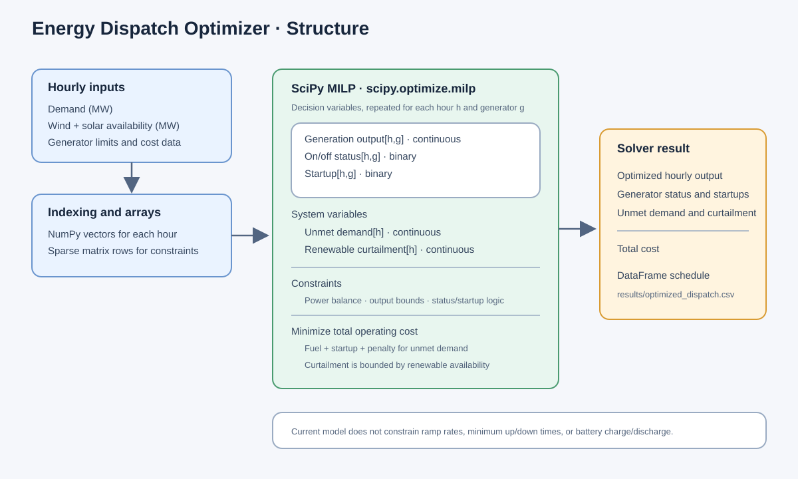

# Energy Dispatch Optimization

A Python project for simulating baseline electricity dispatch and optimizing
generator schedules against hourly demand and renewable generation data.

## Setup

Create and activate a virtual environment, then install the dependencies:

```bash
python -m venv .venv
```

On Windows:

```powershell
.venv\Scripts\Activate.ps1
```

On macOS or Linux:

```bash
source .venv/bin/activate
```

Install the required packages:

```bash
python -m pip install pandas numpy matplotlib scipy
```

## Run

From the project root:

```bash
python main.py
```

The script reads hourly demand, wind, and solar profiles from `data/`, runs
baseline dispatch and optimizations with and without battery storage, and
writes schedules to `results/optimized_dispatch.csv` and
`results/optimized_dispatch_with_battery.csv`. The side-by-side objective
value, fuel/startup costs, unserved energy, curtailment, and battery-use
metrics are saved in `results/optimization_comparison.csv`. The objective
value includes the optimizer's €10,000/MWh penalty for unmet demand, so it
should be read alongside the unserved-energy column.

The baseline simulator charges the battery from generation that would
otherwise be surplus, discharges it to help meet demand before dispatching
conventional generators, and records charge, discharge, and stored energy in
`results/baseline_dispatch.csv`.

## Optimizer structure


